#  Improved Shopping List

## Índice

- [Lista de la compra](#lista-de-la-compra)
- [Catálogo](#catálogo)
- [Stock](#stock)
- [Analítica](#analítica)
- [Ajustes](#ajustes)
- [Disclaimer](#disclaimer)

## Lista de la compra

Desde este apartado puedes consultar y gestionar los productos de la lista seleccionada. En la parte superior aparecen los productos **pendientes de compra** y, debajo, el bloque desplegable **Compras recientes**, con los productos que has marcado como comprados y que todavía se conservan en la lista.

  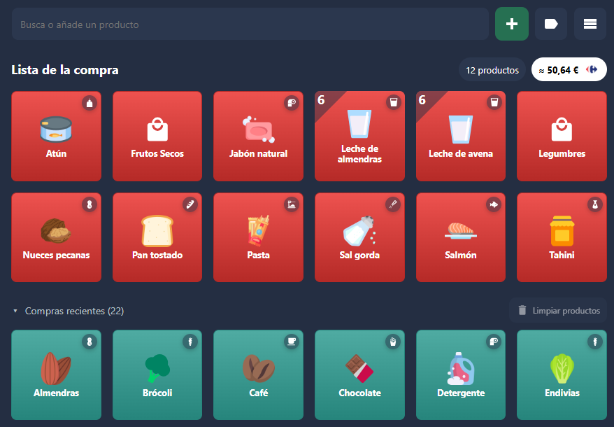

### Marcar productos como comprados o volver a añadirlos

- **Pulsa un producto pendiente** para marcarlo como comprado. Pasará al bloque de Compras recientes.
- **Pulsa un producto de Compras recientes** para devolverlo a los pendientes de compra.
- **Limpiar productos**, dentro de Compras recientes, elimina de la lista todas las entradas completadas. No elimina sus fichas del catálogo.

Los cambios se reflejan en la lista de Home Assistant y en su proveedor, como Bring.

Marcar un producto como comprado no aumenta su Stock ni reinicia su caducidad. La reposición se registra al confirmar la revisión de un ticket o al actualizar manualmente Stock. En el ticket se propone la cantidad recuperada o estimada y, si no está disponible, la cantidad predeterminada de reposición.

### Añadir productos

Utiliza el buscador de la parte superior para escribir el nombre del producto. Mientras escribes, aparecen sugerencias de los productos que ya tienes en el catálogo: pulsa una para añadirla directamente. También puedes seleccionar una sugerencia con las flechas del teclado y pulsar **Enter**.

Si el producto no está en el catálogo, escribe su nombre y pulsa **+** o **Enter** para añadirlo a la lista. Si ya está pendiente, no se crea una entrada duplicada; si estaba en Compras recientes, vuelve a quedar pendiente.

Si tienes varias listas configuradas, el botón de selección de lista permite elegir cuál quieres utilizar. Este botón se oculta cuando solo tienes una lista de la compra.

### Vistas y ordenación

Los controles situados junto al buscador permiten cambiar cómo se muestran los productos:

- **Orden alfabético:** muestra todos los productos ordenados por su nombre.
- **Agrupar por categorías:** reúne los productos según la categoría que tengan asignada en el catálogo, manteniendo el orden alfabético dentro de cada grupo. Los que no tienen categoría aparecen en Sin categoría. Vuelve a pulsar el botón para recuperar el listado sin agrupar.
- **Cuadrícula o filas:** alterna entre bloques cuadrados y una fila completa por producto. En filas se pueden mostrar la categoría, la cantidad, el último precio guardado y el Nutri-Score, cuando esos datos estén disponibles.

La vista y la agrupación se aplican tanto a los productos pendientes como a Compras recientes.

### Precio estimado y comparación entre supermercados

Junto al título Lista de la compra aparecen el **número de productos pendientes** y el **importe aproximado** de la compra. El cálculo utiliza los últimos precios guardados; abrir este apartado no actualiza los precios de las tiendas.

**Pulsa el importe estimado** para cambiar a una vista tipo ticket. En la parte superior se muestran hasta cuatro supermercados que tengan algún precio guardado para los productos pendientes, priorizando los que tienen más productos con precio disponible.

Cada supermercado muestra su logo, el importe estimado y cuántos productos tienen precio respecto al total de la lista. Por ejemplo, **2,50 € (1/17)** indica que solo hay precio para uno de los diecisiete productos pendientes.

Inicialmente se selecciona el supermercado con más productos con precio disponible; si hay empate, se prioriza el de menor importe. **Pulsa otro supermercado** para consultar su ticket, con los productos ordenados alfabéticamente y el precio a la derecha. Los productos sin precio en esa tienda se agrupan en un bloque comprimido que puedes desplegar. Al final aparece el total estimado, que suma únicamente los productos con precio conocido.

  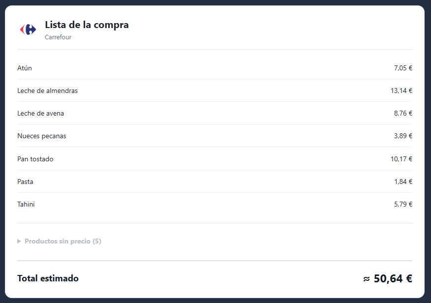

Para volver a la vista habitual de productos, **pulsa el badge del número de productos**.

## Catálogo

El catálogo reúne las fichas de tus productos para utilizarlas en la lista de la compra, Stock y la comparación de precios. Sus vistas son **Productos**, **Categorías** y **Pendiente**.

  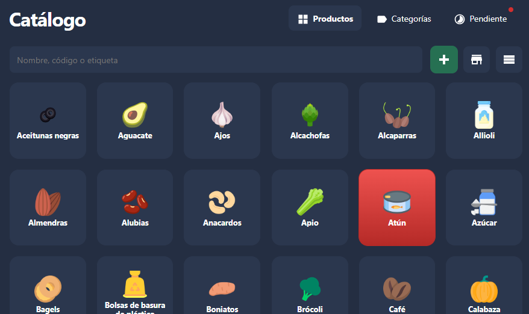

### Añadir productos y asignar imágenes

Desde **Productos**, pulsa **+** para crear una ficha. Puedes empezar con el nombre y completar el resto de la información más adelante.

En la ficha puedes asignar una imagen mediante el campo **URL Imagen/Icono**, indicando la dirección de la imagen que quieras utilizar. También se muestran propuestas de iconos, dando prioridad al catálogo comunitario, cuyas imágenes proceden principalmente de [Iconify](https://iconify.design/) y [Flaticon](https://www.flaticon.es/).

  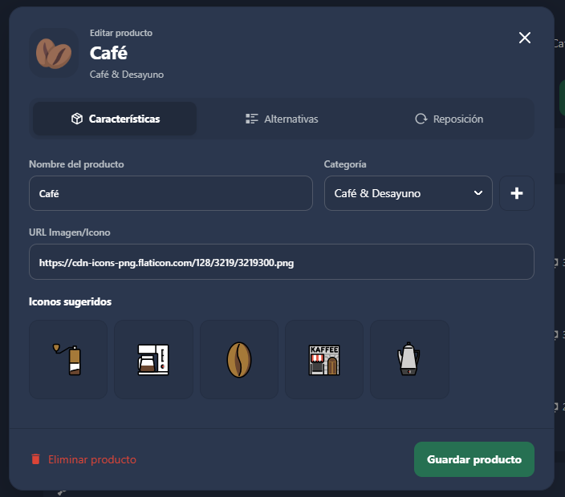

### Organizar por categorías

Puedes crear categorías y asignarles un nombre, un icono y un color. Después, selecciona la categoría correspondiente en la ficha de cada producto; también puedes crear una categoría desde esa misma ficha.

  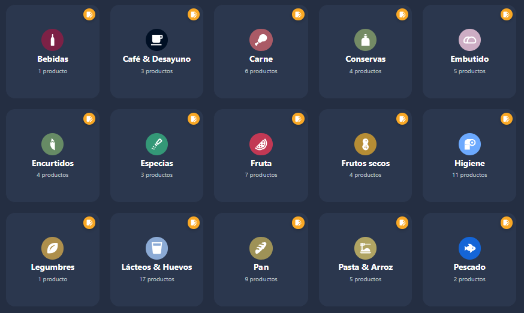

El catálogo permite buscar productos, alternar entre cuadrícula y filas y mostrarlos por orden alfabético o agrupados por categoría. Los grupos se muestran comprimidos y se despliegan al pulsarlos.

  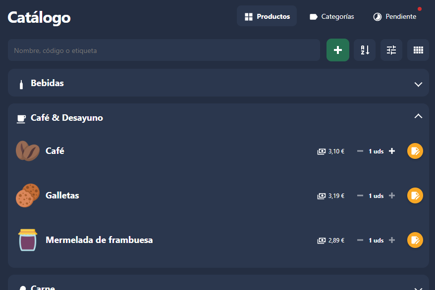

### Alternativas de compra en distintas tiendas

Un mismo producto del catálogo puede tener varias alternativas de compra, tanto de una misma tienda como de distintos supermercados. Por ejemplo, una ficha de «Café» puede reunir distintas marcas y formatos.

En la vista **Alternativas** de la ficha, introduce la **URL del producto** y pulsa **Recuperar datos**. La integración identifica la tienda a partir del enlace e intenta recuperar los datos disponibles, como el nombre comercial, el EAN, la marca, el contenido y el precio, siempre que el supermercado esté soportado y permita la consulta. Puedes revisar y completar los datos manualmente.

Las alternativas con el mismo EAN se agrupan en un bloque: comparten los datos del producto y mantienen por separado la URL y el precio de cada tienda.

### Reposición automática y lectores

La vista **Reposición** de la ficha permite configurar los criterios de reposición automática, coordinados con Stock: productos perecederos, consumo registrado mediante una entidad de Home Assistant o consumo por rutinas. Según el modo elegido, puedes indicar el plazo de caducidad, la cantidad de reposición y el mínimo a partir del cual se solicita la compra.

También puedes asociar **códigos de barras/QR** y **etiquetas NFC** al producto. Al escanearlos con un lector configurado, se ejecuta su acción predeterminada o la acción específica que hayas elegido para ese producto, como añadirlo a la lista o aumentar o reducir su Stock.

### Productos pendientes

La vista **Pendiente** avisa de los productos que requieren revisión y los separa en tres bloques desplegables:

- **Productos añadidos a la lista:** nombres presentes en la lista de la compra que todavía no están incorporados al catálogo.
- **Productos escaneados:** códigos de barras/QR o etiquetas NFC que aún no están asociados a un producto. Puedes vincularlos a una ficha existente o crear una nueva.
- **Productos pendientes de información:** fichas cuyas alternativas necesitan completar precio, contenido por envase o unidad de medida. Si al menos una alternativa está completa, el producto no aparece en este bloque.

## Stock

Este apartado permite llevar el control de los productos de tu despensa. Tú eliges cuáles quieres controlar y cómo se registra su consumo. El Stock es común para todas las listas de la compra y se organiza en las vistas **Stock**, **Rutinas** y **Lectores**.

### Añadir y configurar productos

En la vista **Stock**, pulsa **+** para añadir un producto. Después, pulsa su bloque para abrir la ficha y configurar la cantidad actual, las unidades —uds, g, kg, litros o una unidad personalizada—, el método de control y la cantidad predeterminada de reposición.

Puedes alternar entre cuadrícula y filas, y ordenar los productos alfabéticamente, por menor porcentaje de Stock o agrupados por categoría. En filas también aparecen los controles para aumentar o reducir la cantidad manualmente.

  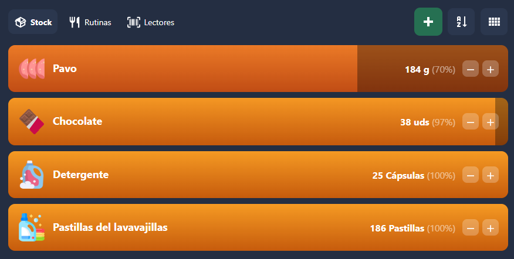

### Métodos de control

Cada producto puede utilizar uno de estos métodos:

- **Manual / lectores:** ajustas la cantidad desde la ficha, con los controles de la vista de filas o escaneando un código asociado con una acción de aumentar o reducir Stock.
- **Perecedero:** indicas cuántos días dura desde la reposición. La cantidad y el porcentaje restante disminuyen proporcionalmente con el tiempo, como estimación de disponibilidad, hasta llegar a cero al caducar. El plazo de caducidad se respeta independientemente de la cantidad repuesta.
- **Consumo registrado:** seleccionas una entidad de Home Assistant, el estado que representa un uso y la cantidad que se descuenta cada vez que la entidad entra en ese estado. Por ejemplo, puedes descontar detergente cuando la lavadora pasa al estado que hayas configurado.
- **Consumo por rutinas:** asignas una o varias rutinas y la cantidad que consume cada persona cuando está en casa durante su franja horaria. Puedes definir cantidades diferentes por persona.

Las opciones automáticas también se pueden configurar desde **Reposición** en la ficha del producto del catálogo. Ambas fichas comparten la misma configuración.

### Stock bajo y reposición

Activa **Añadir a la lista cuando el stock llegue al mínimo** e indica el umbral. En los perecederos se utiliza el porcentaje restante; los demás métodos aplican el mínimo de cantidad o porcentaje configurado. Cuando se alcanza ese mínimo, el producto se añade automáticamente a la lista elegida, sin duplicar una entrada que ya esté pendiente.

Si tienes varias listas de compra, puedes elegir la **Lista para reponer**. El selector se oculta cuando solo hay una; las listas pasarela no cuentan como listas de destino adicionales.

El 100 % corresponde al stock total que queda después de la última reposición. Si quedan 50 g y añades 200 g, los 250 g resultantes serán el nuevo 100 %. Se utiliza la cantidad recuperada o estimada del ticket cuando está disponible; la cantidad predeterminada solo sirve como propuesta cuando no se conoce la comprada.

Para registrar lo comprado, puedes revisar un ticket desde **Analítica → Compras** o actualizar la cantidad manualmente. Al revisar el ticket, se propone la cantidad recuperada o estimada y, si no está disponible, la cantidad predeterminada de reposición. Solo se repone Stock para los productos que selecciones durante la revisión. Marcar un producto como comprado en la lista no aumenta por sí solo su Stock.

### Rutinas

Una rutina define **qué personas**, **en qué franja horaria** y **qué días de la semana** se tienen en cuenta para registrar un consumo habitual en casa.

En **Rutinas**, pulsa **+**, escribe un nombre, selecciona las personas y configura la hora de inicio, la hora de fin y los días. Después, en la ficha del producto, elige **Consumo por rutinas**, marca la rutina e indica cuánto consume cada persona.

Si una persona ha estado en casa en algún momento de esa franja, se descuenta la cantidad configurada una vez por persona y franja. Por ejemplo, una rutina de desayuno de 08:00 a 10:00 puede descontar una unidad de chocolate por cada persona seleccionada que haya estado en casa durante ese intervalo. La presencia se obtiene de sus entidades **person** de Home Assistant.

Las tarjetas se ordenan por hora de inicio. Su toggle permite activarlas o desactivarlas y, al pulsar una tarjeta, puedes editarla o eliminarla desde el popup.

  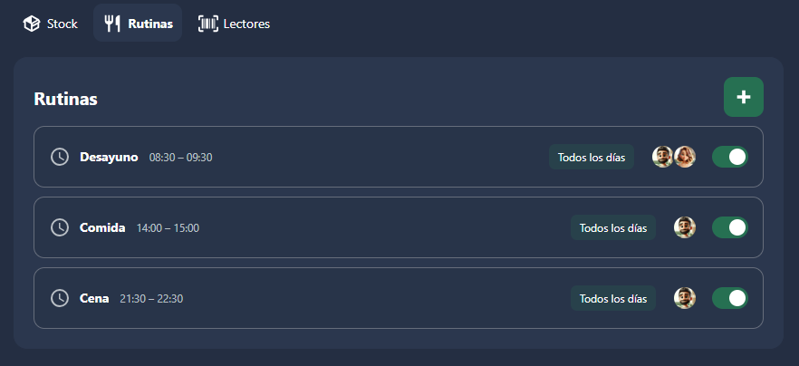

### Lectores

Los lectores conectan las lecturas de **códigos de barras/QR** o **etiquetas NFC** con los productos del catálogo. En **Lectores**, pulsa **+**, asigna un nombre y selecciona el tipo y la fuente: una entidad de Home Assistant que reciba el código o, para NFC, el evento **tag_scanned** del dispositivo correspondiente.

Configura la **acción por defecto**, la lista de destino y el intervalo de **antirrepetición**, que inicialmente es de 60 segundos. Este intervalo evita procesar repetidamente una misma lectura por error.

Desde **Reposición** en la ficha de cada producto puedes escanear y asociar uno o varios códigos o etiquetas. Para cada lector se utiliza su acción predeterminada, salvo que elijas una acción específica para ese producto: añadirlo a la lista, aumentar Stock, reducir Stock o no realizar ninguna acción. Para modificar Stock, el producto debe estar incluido previamente en él.

Cada tarjeta permite activar o desactivar el lector, consultar las lecturas en directo, editarlo o quitarlo. También muestra la fecha y hora de su último uso. Los códigos desconocidos aparecen en **Catálogo → Pendiente** para vincularlos a un producto existente o crear uno nuevo. Los lectores siguen funcionando aunque cierres la interfaz.

  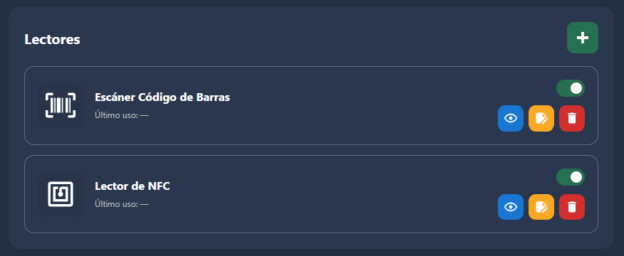

## Analítica

Analítica permite consultar tus compras, entender cómo se reparte el gasto, comparar los precios guardados y conocer la información nutricional de los productos de tu catálogo. Se organiza en cuatro vistas: **Compras**, **Gastos**, **Comparativa** y **Nutrición**.

### Compras

Es la vista inicial. Muestra las compras registradas y una gráfica de gasto mensual, con un color por tienda. Puedes elegir el periodo de fechas, filtrar por tienda o persona y consultar compras anteriores con **Mostrar más**.

  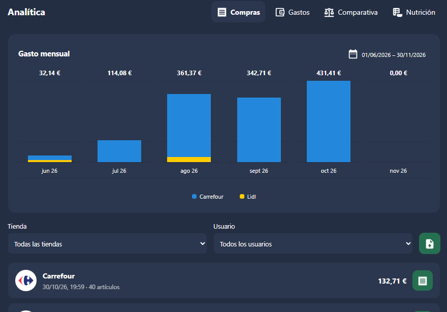

#### Cómo se obtienen las compras

- **Conectando una cuenta en Ajustes → Tiendas → Cuentas.** Actualmente se pueden conectar Carrefour y Lidl. Según las opciones que actives, la integración permite recuperar las compras de los últimos doce meses y descargar automáticamente nuevos tickets cuando se detecta una compra. También incorpora al histórico otras compras que encuentre durante esas consultas. El histórico puede mostrar la tienda, fecha e importe aunque todavía no hayas revisado el ticket.
- **Subiendo un ticket o una factura.** Utiliza el botón de subir ticket de esta vista. El supermercado y el formato del documento deben estar soportados: actualmente, la subida manual reconoce tickets y facturas PDF de Carrefour que contienen texto. Los documentos escaneados como imagen requieren un tratamiento distinto y no se reconocen mediante OCR.
- **Mediante la detección automática de compra, si la has configurado.** Completar más de la cantidad indicada de productos durante un día permite detectar una compra. Las personas y zonas configuradas ayudan a identificar la tienda. Si no se encuentra un ticket o no se identifica la tienda, puedes completar sus datos manualmente o adjuntar un documento compatible.

El icono del ticket de cada compra abre su revisión o recupera el detalle desde la cuenta conectada, cuando está disponible. El icono aparece en verde cuando el ticket ya se ha revisado. Recuperar una compra en el histórico no repone por sí solo el Stock ni confirma todos sus productos.

#### Para qué sirve revisar un ticket

La revisión convierte los nombres y cantidades del supermercado en información útil para tu catálogo y tu despensa. El asistente permite comprobar los datos antes de aplicarlos y se divide en cuatro pasos:

1. **Vinculación.** Relaciona cada línea del ticket con un producto de tu catálogo o crea uno nuevo. Las líneas que no vincules se ignoran para las operaciones sobre productos. Las asociaciones se guardan para reconocer futuras compras de esa tienda, aunque no incluyas el producto en Stock. Varias líneas pueden corresponder al mismo producto genérico, conservando sus alternativas comerciales y sus EAN cuando están disponibles.
2. **Stock.** Selecciona los productos que quieres reponer y confirma la cantidad y las unidades. Los que ya están en Stock aparecen seleccionados inicialmente; puedes incluir otros o desmarcarlos. Se propone la cantidad recuperada del ticket o estimada a partir de un precio por unidad de medida y, cuando no se conoce, la cantidad predeterminada de reposición. Puedes corregirla antes de guardar. Marcar un producto como comprado en la lista no aumenta por sí solo el Stock.
3. **Precios.** Selecciona los productos vinculados cuyo precio quieres guardar para esa tienda. Cuando se dispone de ellos, también se aprovechan el EAN y los datos de formato del producto, como el contenido del envase. En un producto al peso, el importe total pagado no sustituye al precio por kg: se utiliza una tarifa identificada en el ticket o el valor que confirmes manualmente.
4. **Resumen.** Comprueba las vinculaciones, las reposiciones y los precios seleccionados y confirma la compra para guardar los cambios.

  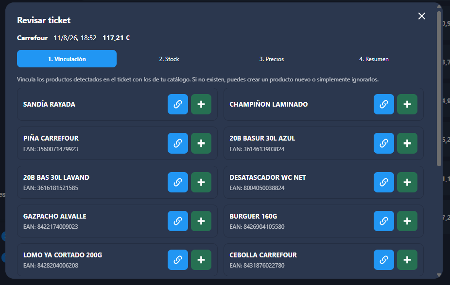

También puedes guardar solo las vinculaciones y cerrar, o utilizar las opciones de guardar Stock o precios y cerrar sin completar todos los pasos. Las acciones dependen de lo que hayas seleccionado. Reprocesar los datos de un ticket ya revisado permite completar alternativas y formatos del catálogo sin volver a reponer Stock.

### Gastos

Utiliza las compras registradas en el periodo elegido para mostrar **Gasto total**, **Compras** e **Importe medio**, en euros. Los datos proceden del histórico, tanto de compras recuperadas de cuentas como de documentos revisados y compras completadas manualmente.

  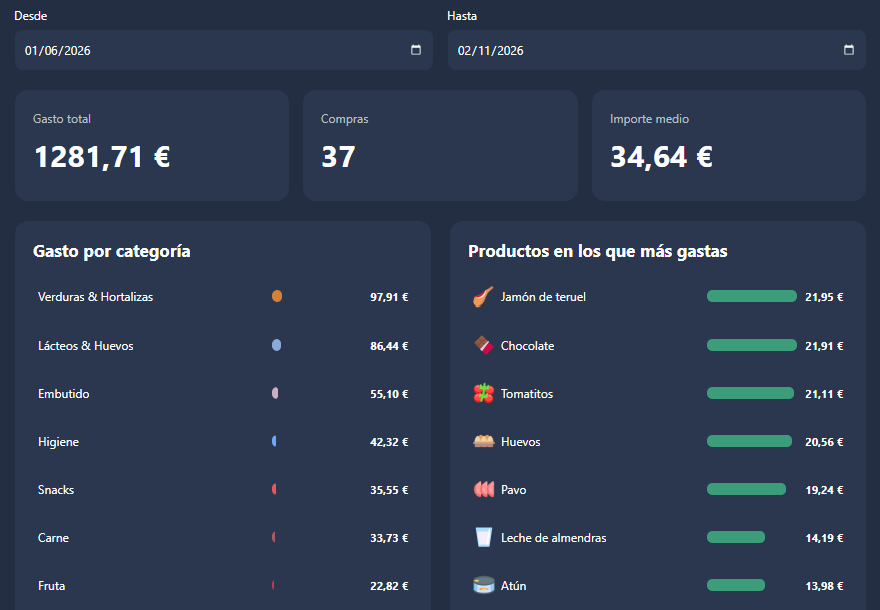

- **Gasto por categoría:** muestra las nueve categorías con más gasto, con el color configurado para cada una. El resto y los importes sin clasificar se agrupan en **Otros**. Permite reconocer qué tipos de productos concentran el gasto.
- **Productos en los que más gastas:** muestra los diez productos vinculados con mayor importe acumulado en el periodo. Sirve para localizar los que más pesan en tu presupuesto; el importe es el gasto acumulado en ellos, no el precio de un solo envase.
- **Gasto por tienda:** muestra cuánto has gastado en cada tienda. Puedes pulsar una barra para filtrar el análisis por esa tienda.
- **Compras por persona:** muestra el número de compras y el importe asociados a cada persona registrada como compradora. Puedes pulsar su barra para filtrar. Una compra compartida cuenta para cada participante, sin repartir su importe entre ellos, pero se suma una sola vez al gasto total.

Para clasificar el gasto por categoría o producto es necesario que las líneas de los tickets estén vinculadas al catálogo. Las categorías utilizadas son las actuales del catálogo. Los descuentos generales se distribuyen proporcionalmente; los gastos de envío y los importes sin detalle quedan en **Otros**. Por eso una compra recuperada solo con fecha e importe contribuye al total, aunque todavía no pueda repartirse entre productos y categorías.

### Comparativa

Utiliza los precios y los formatos guardados en las alternativas del catálogo. Estos datos pueden proceder de la revisión de tickets y facturas, de la edición manual o de las fichas web y catálogos de supermercados compatibles que hayas habilitado. Abrir esta vista analiza los datos guardados; no actualiza los precios consultando las tiendas.

Se incluyen los productos que tienen precios comparables en al menos dos tiendas. La comparación se realiza por la misma unidad —**€/kg**, **€/l** o **€/ud**— y puede comparar alternativas de distintas marcas y EAN de un mismo producto genérico. Para ello deben estar informados el tipo de venta y los datos de formato necesarios. Las alternativas sin información suficiente para calcular un precio comparable no se incluyen.

- **Dónde están los precios más bajos:** muestra las tiendas que tienen al menos un precio mínimo. Los empates cuentan para las tiendas correspondientes.
- **Dónde puedes ahorrar más:** destaca los productos con mayores diferencias porcentuales entre tiendas e indica también la diferencia por unidad de medida.
- **La misma cesta de referencia:** compara una cantidad de referencia por producto —una unidad, un kg o un litro— utilizando solo productos comparables en todas las tiendas mostradas. Sirve para comparar la misma selección; no representa necesariamente las cantidades de tu lista de la compra.
- **Precios del catálogo:** muestra los precios comparables por producto y tienda, su fecha y la diferencia máxima. Permite ordenar alfabéticamente o por diferencia absoluta o porcentual.

  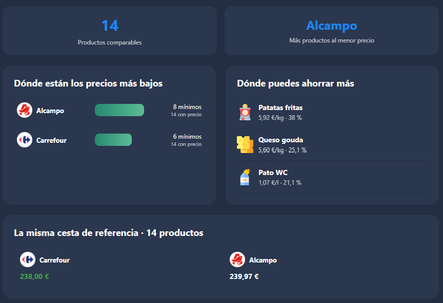

Al pulsar una tienda en el gráfico o en la cabecera de la tabla se priorizan los productos más baratos en ella. Una segunda pulsación deja solo esos productos y una tercera elimina la selección. Las fechas ayudan a valorar si los precios guardados siguen siendo recientes; los importes mostrados pueden haber cambiado en la tienda.

### Nutrición

Utiliza el catálogo completo y sus EAN para mostrar dos gráficos independientes:

- **Nutri-Score:** distribuye los productos con una calificación disponible entre A y E. Los productos sin calificación no se incluyen en sus porcentajes. Cada producto genérico cuenta una vez en la distribución.
- **Grado de procesamiento:** agrupa los productos según NOVA en sin procesar o mínimamente procesados, ingredientes culinarios, procesados y ultraprocesados. Los colores van de verde a rojo según aumenta el procesamiento. Solo se clasifican los productos para los que existe ese dato; un producto con alternativas de distinto procesamiento puede aparecer en más de un grupo.

  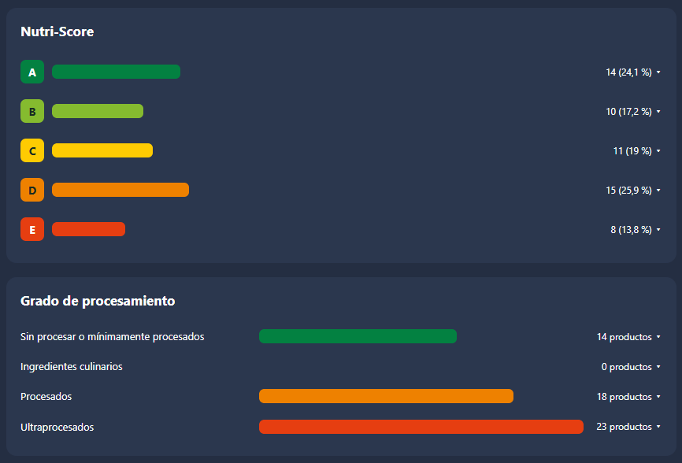

Pulsa una calificación o un grupo para desplegar sus productos y abrir sus fichas. Desplegar un grupo no filtra el otro gráfico. Esta vista ayuda a conocer la composición del catálogo; no representa las cantidades que has consumido ni una valoración de tu dieta.

La integración busca primero Nutri-Score y NOVA en la caché local y en el diccionario comunitario por EAN. Si falta información vigente, consulta [Open Food Facts](https://world.openfoodfacts.org/) por coincidencia exacta de EAN y conserva los resultados en una caché persistente. El diccionario incluye la fuente, fecha de consulta y versión del cálculo de Nutri-Score cuando está disponible. Al abrir la vista intenta completar la información sin caché vigente, con consultas espaciadas. Los datos encontrados se reutilizan durante treinta días para evitar repetir llamadas. Open Food Facts es una base colaborativa y puede contener información incompleta: no se deduce una clasificación a partir del nombre del producto.

Analítica no requiere tarjetas adicionales de HACS.

## Ajustes

Ajustes se organiza en **General**, **Tiendas** e **Información**. Sus bloques se pueden desplegar para consultar y modificar la configuración. Para guardar cambios necesitas una cuenta administradora de Home Assistant.

### General

- **Listas de la compra:** añade las entidades **todo** que quieres utilizar y marca con la estrella la lista principal. Esta será el destino predeterminado cuando no hayas elegido otra. Quitar una lista de la integración no elimina su entidad ni sus productos de Home Assistant. Si el proveedor utiliza una descripción como segunda línea del nombre —como «Leche» y «de avena» en Bring—, puedes activar **Usar la descripción como parte del nombre** para esa lista.
- **Listas pasarela:** selecciona una entidad **todo**, la lista de destino y si los productos deben conservarse en la pasarela o eliminarse después de transferirlos. Solo se transfieren las nuevas incorporaciones desde que la configuras, sin duplicar productos pendientes en el destino. Estas listas sirven, por ejemplo, para recoger productos añadidos mediante un asistente de voz.
- **Personalización:** elige los colores inicial y final de los degradados de productos pendientes, comprados y en Stock, con una vista previa. También puedes ajustar los productos por fila en ordenador y móvil o restablecer los valores predeterminados.
- **Notificaciones:** configura avisos cuando una lista supere un número de productos pendientes o cuando haya más de cierto número de productos con Stock bajo. Cada aviso permite seleccionar uno o varios dispositivos de destino, el umbral, el título y el mensaje. El aviso de lista se evalúa de forma independiente para cada lista configurada. Se envía al superar el límite y vuelve a poder enviarse cuando el recuento baja hasta ese límite o por debajo y lo supera otra vez.

Los destinos de notificación son los servicios y entidades **notify** disponibles en tu Home Assistant; deben estar configurados previamente para poder seleccionarlos.

### Tiendas: cuentas, catálogos y establecimientos

En esta vista se distinguen las **cuentas conectadas**, que permiten recuperar tus compras, los **catálogos públicos**, que completan información de productos, y las **tiendas físicas**, que se utilizan para identificar dónde has comprado mediante las zonas de Home Assistant.

#### Cuentas conectadas

Actualmente puedes conectar **Carrefour** y **Lidl**. Activa la cuenta que quieras utilizar y abre su configuración para conectarla o desconectarla.

- **Carrefour:** introduce el correo y la contraseña. Puedes activar **Recordar credenciales** para conservarlas en tu instancia y facilitar la reconexión cuando sea necesaria.
- **Lidl:** sigue el asistente de acceso a la web oficial y selecciona el archivo **HAR** del inicio de sesión. El asistente explica cómo obtenerlo desde las herramientas del navegador. El archivo se interpreta en tu navegador y solo se envía a Home Assistant la autorización de ese intento, que permite guardar una sesión renovable.

La sesión y, cuando lo solicitas, las credenciales se conservan en tu Home Assistant; no se publican en el repositorio comunitario. La tienda puede caducar o invalidar una sesión, en cuyo caso será necesario renovarla o volver a conectar la cuenta.

Cada cuenta ofrece dos opciones, disponibles cuando está conectada:

- **Recuperar compras de los últimos 12 meses:** incorpora a **Analítica → Compras** las compras disponibles dentro de ese periodo móvil, con sus datos básicos, como fecha, tienda e importe. No se limita al año natural ni obliga a revisar todos los tickets. Puedes abrir el ticket de una compra desde su icono para revisarlo cuando lo necesites.
- **Descargar ticket automáticamente:** permite consultar la cuenta después de detectar actividad de compra y guardar el ticket pendiente de revisión. Las consultas automáticas están limitadas para evitar accesos continuos. Descargarlo no repone Stock ni actualiza precios por sí solo: esos cambios se confirman en la revisión del ticket. Cuando una consulta encuentra otras compras aún no registradas, también puede incorporarlas al histórico, sin obligarte a revisar sus tickets.

#### Catálogos públicos de productos y precios

Los catálogos disponibles incluyen **Alcampo, Mercadona, Masymas, BM, Consum, La Sirena y Eroski**. No requieren conectar una cuenta de comprador. Están desactivados inicialmente: activa únicamente los que quieras utilizar como fuente de información.

Al activar uno, la integración busca coincidencias por **EAN** para los productos que necesitan información, reutilizando los datos y enlaces ya conocidos antes de consultar la tienda. Cuando hay una coincidencia confirmada, intenta completar los campos disponibles, como marca, contenido, unidad de medida, formato y precio. La información que ofrece cada supermercado puede variar y no todos los EAN tendrán coincidencias.

El engranaje de cada catálogo permite configurar **Mostrar tienda en el catálogo**:

- **Desactivado:** utiliza la tienda como fuente para completar los datos comunes del producto, sin mostrarla como alternativa de compra.
- **Activado:** también incorpora su referencia, URL y precio disponible como alternativa de esa tienda. Podrás verla al agrupar los productos por tienda y utilizar sus precios en las comparaciones cuando exista un formato comparable.

Los datos recuperados se conservan para reutilizarlos, también si más adelante cambias la visibilidad de la tienda. Las consultas se procesan en segundo plano, con una espera de **20 segundos** entre peticiones de estos procesos de completado y con pausas adicionales ante bloqueos o errores. El progreso y las incidencias se pueden consultar sin que sea necesario mantener abierta la interfaz.

Los precios guardados son referencias de la última consulta o compra registrada: no implican una consulta en tiempo real al abrir una ficha o una comparativa. Las fuentes públicas utilizan ubicaciones de referencia de la integración, por lo que sus precios o disponibilidad pueden diferir de los de tu establecimiento.

Los controles de **actualización de precios** permiten solicitar una revisión manual y configurar la actualización automática, su frecuencia en días y su hora. La frecuencia mínima es de un día y la hora inicial se asigna de forma aleatoria para repartir las consultas entre instalaciones. Esta programación de precios es distinta de las opciones de recuperación de tickets de las cuentas conectadas.

#### Tiendas físicas y personas

En el bloque **Tiendas**, pulsa **+** para crear un establecimiento. Puedes indicar nombre, imagen y color, asociarlo a una cuenta compatible y seleccionar una o varias entidades **zone**. Si eliges una cuenta vinculada, se proponen su nombre, imagen y color. El popup también permite crear zonas y consultar su posición en el mapa.

En **Usuarios**, marca las tarjetas de las personas que realizan las compras. Se utilizan sus entidades **person** de Home Assistant para comprobar las visitas; los avatares ayudan a identificar a quién estás seleccionando.

#### Detección automática de compras por zonas

1. Activa **Detección automática de compra** e indica el umbral de productos completados en un mismo día. Se suman las listas de compra configuradas; la compra se detecta cuando se supera ese umbral, no al alcanzarlo.
2. Activa **Asignación de tienda basada en zona**, selecciona las personas y asigna las zonas a los establecimientos. Configura la **permanencia mínima en la zona**, en minutos: pasar cerca de una tienda sin permanecer ese tiempo no basta para identificarla como lugar de compra.
3. Cuando una persona seleccionada cumple esa permanencia, la visita se utiliza para proponer la tienda de la compra y registrar las personas relacionadas. Si varias zonas cumplen el criterio, pueden generarse compras separadas para esos establecimientos.
4. Si el establecimiento tiene una cuenta conectada y la descarga automática está activada, se intenta recuperar su ticket. Se priorizan las cuentas correspondientes a las zonas visitadas; entre las restantes elegibles se tiene en cuenta la tienda favorita. Una vez confirmada una compra, no se continúa buscando ese mismo registro en las demás cuentas.

La ubicación orienta la búsqueda, pero no sustituye al ticket. Para asociarlo automáticamente se comprueba la relación con la fecha y los productos completados que se pueden reconocer. Si no hay un ticket coincidente o la tienda no permite recuperarlo, queda una compra pendiente en **Analítica → Compras**, donde puedes indicar la tienda y el importe, subir un ticket compatible o intentar recuperar la compra desde una cuenta conectada.

Los productos completados en la lista sirven como señal de que has comprado. Cuando se recupera el ticket, el detalle real de la compra procede de este: puede incluir productos adicionales o no contener todos los que habías marcado. La detección no vuelve a reponer Stock por sí sola.

### Información y catálogo comunitario

En **Información** encontrarás el bloque **Comunidad** y, debajo, los **Logs**.

Desde Comunidad puedes **exportar tu catálogo** en un archivo JSON con nombres, categorías, iconos o enlaces de imágenes, EAN, alternativas de compra, formatos, precios guardados y clasificaciones nutricionales disponibles. Puedes compartir ese archivo con Aguacatec para ampliar el diccionario comunitario. La exportación es manual: pulsar el botón descarga el archivo, no lo publica automáticamente. También encontrarás los enlaces para unirte a la comunidad y apoyar el proyecto.

El catálogo comunitario ayuda a completar información sin repetir consultas innecesarias. Se utiliza de dos formas:

- **Propuestas de imágenes:** se priorizan las sugerencias comunitarias para el nombre del producto antes de recurrir a otras fuentes de iconos.
- **Información por EAN:** el diccionario puede aportar enlaces de las tiendas y datos comunes, como marca, contenido, unidad de medida, unidades incluidas y clasificaciones nutricionales con su fuente y fecha. Para estos datos se exige coincidencia de EAN; un nombre parecido no confirma que sea el mismo producto.

La integración conserva una copia local de los diccionarios y reutiliza su caché. En la búsqueda de datos por EAN, consulta primero la información local y comunitaria; si no basta, recurre a los catálogos habilitados que permiten buscar por EAN y, después, a los demás métodos compatibles. Así, un enlace o formato ya conocido evita repetir su búsqueda. Los índices comunitarios se comprueban periódicamente, sin necesitar una nueva versión de la integración para recibir sus actualizaciones.

El diccionario comunitario no es un servicio de precios en tiempo real: los precios de tus alternativas proceden de los tickets que revisas, de las consultas compatibles a las tiendas o de los valores que introduces manualmente. La caché, las esperas y las pausas de reintento reducen las llamadas, pero no garantizan que una web externa acepte todas las consultas.

Los **Logs** permiten consultar la actividad de listas, Stock, lectores, catálogo, cuentas y tiendas, filtrarla y revisar la información técnica de las incidencias. Son el lugar donde comprobar qué datos se han completado o por qué una consulta ha quedado pausada o no ha obtenido resultados.

## Disclaimer

### ¿De dónde salen los datos?

Seguimos una política transparente sobre el origen de la información. El objetivo principal es que sea el propio usuario quien aporte los datos de sus compras, mediante sus **tickets y facturas**, los datos recuperados de las cuentas que decide conectar y las correcciones que confirma al revisarlos. Junto con estos datos, damos prioridad a la información disponible en el **repositorio comunitario**, para reutilizar enlaces, formatos y otros datos ya conocidos sin tener que buscarlos de nuevo.

Cuando falta información, se puede completar con datos públicos de los supermercados compatibles y otras fuentes indicadas en esta documentación, según las opciones que active el usuario. Reutilizamos la caché local y el diccionario comunitario, espaciamos las peticiones y aplicamos pausas ante errores o rechazos. Así buscamos **minimizar las llamadas**, reducir el consumo de recursos de los servicios externos y evitar bloqueos; no se pretende consultar continuamente ni replicar sus catálogos completos.

Aportar datos al catálogo personal no los publica automáticamente. Las contribuciones al repositorio comunitario se realizan mediante la exportación y el envío voluntario del archivo por parte del usuario, como se explica en Ajustes.

Este es un **proyecto independiente**, sin vinculación oficial ni respaldo de los supermercados o servicios cuyas cuentas permite conectar. Las marcas pertenecen a sus respectivos titulares. Los posibles enlaces de afiliado se declaran por separado en el apartado Marketing de afiliados.

Los **precios son orientativos** y pueden no ser exactos o estar desactualizados. Reflejan la última información guardada y pueden variar según la fecha, el establecimiento, la ubicación, el formato, las promociones o los descuentos personales. Los importes estimados y las comparativas no garantizan el precio final de una compra; el importe válido será el que confirme la tienda.

### Referencias

- **Inspiración del diseño:** el diseño visual de la lista de la compra está inspirado en la aplicación [Bring!](https://www.getbring.com/).
- **Iconos e imágenes de productos:** las sugerencias del catálogo comunitario proceden principalmente de [Iconify](https://iconify.design/) y [Flaticon](https://www.flaticon.es/). Cada recurso tiene sus propios autores y condiciones de uso; en Iconify, las licencias corresponden a cada colección de iconos. También puedes asignar tus propias imágenes mediante una URL.
- **Iconos de la interfaz:** se utilizan [Material Design Icons de Pictogrammers](https://pictogrammers.com/library/mdi/), a través de Home Assistant, y [Font Awesome](https://fontawesome.com/) en algunos botones de Comunidad.
- **Datos de productos y nutrición:** se utiliza [Open Food Facts](https://world.openfoodfacts.org/), una base de datos colaborativa consultada por EAN, como fuente de información de productos, Nutri-Score y clasificación NOVA. La disponibilidad y precisión dependen de los datos aportados a esa fuente.

### Marketing de afiliados

Algunos enlaces para consultar productos en las tiendas pueden ser enlaces de afiliado. Si accedes a través de ellos y realizas una compra, Aguacatec puede recibir una comisión.
